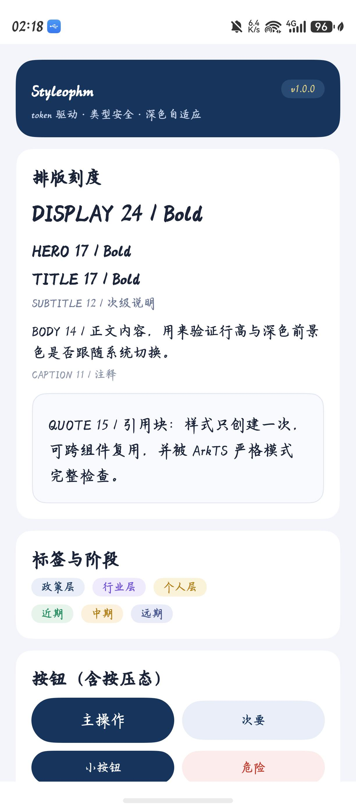
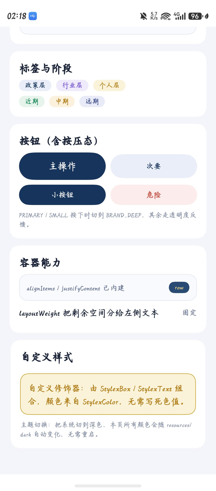

# Styleophm

**StyleX 思路的 HarmonyOS ArkUI 样式库**：用「命名 token + 类型化 `AttributeModifier`」替代动态样式对象，写法接近 StyleX，但完全符合 ArkTS 严格模式（无索引签名、无 `any`、无动态属性访问）。

> Typed style primitives & design tokens for ArkUI — named tokens, reusable `AttributeModifier` presets, dark-mode ready, zero `any`.

```ts
import { PactBox, PactText, StylexColor } from 'styleophm';

Text('五年规划')
  .attributeModifier(PactText.HERO)

Column() { /* ... */ }
  .attributeModifier(PactBox.CARD)
```

- 许可证：MIT · 模块类型：HAR · 编译目标：HarmonyOS 6.1.1（API 24）/ `targetSdkVersion 26.0.1`
- 深浅色：颜色走资源化 token（`StylexColor`），系统切深色自动跟随
- 自带示例工程：`entry` 模块是视觉回归页，改动样式后一眼能看出偏差

---

## 预览

真机（nova 14 Pro / HarmonyOS 7.0.0）截图，左边是排版刻度与标签，右边是按钮、容器能力与自定义修饰器：

<a href="docs/preview-top.jpg"></a>
<a href="docs/preview-bottom.jpg"></a>

---

## 为什么不用 stylex.create？

Web 版 StyleX 依赖动态键访问与结构化对象，在 ArkTS 中会触发：

- `arkts-no-props-by-index`（`style[color]` 这类索引访问）
- `arkts-no-untyped-obj-literals`（匿名样式对象）
- `arkts-no-obj-literals-as-types`

本库的解法：

1. `StylexToken` 管标量刻度（间距 / 圆角 / 字号 / 行高 / 十六进制色值），`StylexColor` 管资源化颜色；
2. `StylexText / StylexBox / StylexTag / StylexButton / StylexRow` 是对应 ArkUI 组件的 `AttributeModifier` 实现，构造时传入**有类型的 Spec**，构造瞬间做一次浅拷贝；
3. 预设样式（`PactText` / `PactBox` / `PactTag` / `PactButton` / `PactAccent`）以静态只读实例暴露，组件里一行 `.attributeModifier(...)` 即可复用。

这样样式只创建一次、可跨组件复用，并且能被 ArkTS 编译器完整类型检查；外部再改 Spec 对象也不会偷偷影响已经建好的样式。

---

## 安装

### 方式一：本地路径依赖（开发期）

在使用方工程根目录 `oh-package.json5`：

```json5
{
  "dependencies": {
    "styleophm": "file:../Styleophm/styleophm"
  }
}
```

然后同步依赖：

```bash
ohpm install
```

### 方式二：HAR 产物

```bash
devecocli build --build-mode release   # 或 DevEco Studio Build > Make Module 'styleophm'
```

产物位于 `styleophm/build/default/outputs/default/styleophm.har`，可直接放入 `libs/` 引用。

---

## 目录

```text
Styleophm/
├─ styleophm/                       HAR 模块（对外发布的部分）
│  ├─ Index.ets                     统一导出（使用方从这里 import）
│  ├─ oh-package.json5              包元信息（license / keywords / repository）
│  └─ src/main/
│     ├─ module.json5               type: har
│     ├─ ets/
│     │  ├─ Stylex.ets              核心 AttributeModifier 实现 + Spec 类型
│     │  ├─ StylexTokens.ets        StylexToken（标量）+ StylexColor（资源化颜色）
│     │  └─ PactStyles.ets          预设样式（PactText/PactBox/PactTag/PactButton/PactAccent）
│     └─ resources/
│        ├─ base/element/color.json 浅色颜色表
│        └─ dark/element/color.json 深色颜色表
├─ entry/                           示例 App（HAP），视觉回归页
├─ AppScope/                        app.json5 与 app 级资源
├─ scripts/guard.mjs                静态守卫：token 纪律 / 调色板 / 导出 / 严格模式 / 版本
├─ .github/workflows/ci.yml         CI：guard 必跑，hvigor 构建按需
├─ CHANGELOG.md
└─ LICENSE（MIT）
```

---

## API

### 核心修饰器

| 类 | 作用组件 | Spec 主要字段 |
| --- | --- | --- |
| `StylexText` | `Text` | `size` `weight` `color` `lineHeight` `maxLines` `align` `letterSpacing` `ellipsis` `overflow` `fontFamily` `decoration` `background` `paddingH` `paddingV` `radius` |
| `StylexTag` | `Text` | 同 `StylexText`（继承实现，`StylexTagSpec` 是其别名） |
| `StylexBox` | `Column` | `width` `height` 四向 `padding`·`margin` `background` `radius`（含四角独立） 四边 `border*Width` `borderColor` `opacity` `alignItems` `justifyContent` `layoutWeight` `flexGrow` `flexShrink` `clip` |
| `StylexRow` | `Row` | 同 `StylexBox`，`alignItems` 类型为 `VerticalAlign` |
| `StylexButton` | `Button` | `width` `height` `size` `weight` `color` `background` `radius` `stateEffect` `pressedBackground` `pressedOpacity` |

要点：

- **颜色字段统一是 `ResourceColor`**：既接受 `StylexColor.INK`（跟随深浅色），也接受 `'#1B2438'` 这类字符串；
- **边框颜色默认补 `StylexToken.LINE`**：只写 `borderWidth` 不会得到黑边；
- **`maxLines` 自动配省略号**：默认 `TextOverflow.Ellipsis`，要硬裁切就显式 `ellipsis: false` 或 `overflow: TextOverflow.Clip`；
- **按钮有按压态**：`applyPressedAttribute` 生效，默认透明度 0.82，可用 `pressedBackground` 换成更深的品牌色。

> **覆盖顺序**：`attributeModifier` 的属性优先级高于链式调用。想改预设的某个属性（例如把卡片内容改成居中），请在 Spec 里给（或另建一个 `StylexBox`），不要指望在 `.attributeModifier(...)` 之后追加同名方法去覆盖——实测会被预设覆盖回去。

### Token（两级制）

第一级 · 标量 `StylexToken`：

| 组 | 取值 |
| --- | --- |
| 颜色（hex） | `INK` `INK_SOFT` `INK_FAINT` `BRAND` `BRAND_DEEP` `BRAND_SOFT` `GOLD` `GOLD_SOFT` `SURFACE` `SURFACE_SOFT` `CANVAS` `LINE` `NEUTRAL_SOFT` `DANGER` `DANGER_SOFT` `SUCCESS` `VIOLET` `VIOLET_SOFT` `GREEN_SOFT` `AMBER` `AMBER_SOFT` `SLATE` `SLATE_SOFT` `ON_DARK` `ON_DARK_SOFT` `ON_DARK_GOLD` `ON_DARK_BRAND` |
| 间距 | `SPACE_2XS 2` `SPACE_XS 4` `SPACE_SM 8` `SPACE_MD 12` `SPACE_LG 16` `SPACE_XL 24` `SPACE_2XL 32` |
| 圆角 | `RADIUS_XS 9` `RADIUS_SM 10` `RADIUS_MD 14` `RADIUS_LG 16` `RADIUS_XL 20` `RADIUS_2XL 24` `RADIUS_PILL 999` |
| 字号 | `FONT_CAPTION 11` `FONT_LABEL 12` `FONT_BODY 14` `FONT_BODY_LG 15` `FONT_TITLE 17` `FONT_DISPLAY 24` |
| 行高 | `LINE_CAPTION 16` `LINE_LABEL 18` `LINE_SOFT 21` `LINE_BODY 22` `LINE_TITLE 24` `LINE_LOOSE 26` `LINE_HERO 27` `LINE_DISPLAY 32` |

第二级 · 资源化颜色 `StylexColor`：与 `resources/{base,dark}/element/color.json` 一一对应，27 个键两套值，界面里请一律用它。

```ts
import { StylexColor } from 'styleophm';

Column().backgroundColor(StylexColor.SURFACE)   // 深色模式自动变 #151C28
```

### 预设与枚举

```ts
import { PactAccent, PactBox, PactButton, PactLayer, PactStage, PactTag, PactText } from 'styleophm';

Text('标题').attributeModifier(PactText.TITLE)
Column() { /* ... */ }.attributeModifier(PactBox.CARD)
Button('保存').attributeModifier(PactButton.PRIMARY)
Text('政策层').attributeModifier(PactTag.forLayer(PactLayer.POLICY))
Text('近期').fontColor(PactAccent.forStage(PactStage.NEAR))
```

- `PactLayer`：`POLICY`（政策层）/ `INDUSTRY`（行业层）/ `PERSONAL`（个人层）
- `PactStage`：`NEAR`（近期）/ `MID`（中期）/ `FAR`（远期）
- 首选用枚举：拼错是编译错误，不再是静默落到 `NEUTRAL`；传字符串仍然兼容。

> `PactXxx` 预设来自一个真实项目（五年之约）的视觉体系，作为「如何组织 token 与预设」的参考实现。实际项目可以按同样方式编写自己的 `AppText` / `AppBox`。

---

## 自定义样式

```ts
import { StylexBox, StylexText, StylexColor, StylexToken } from 'styleophm';

const NoticeBox: StylexBox = new StylexBox({
  background: StylexColor.GOLD_SOFT,
  radius: StylexToken.RADIUS_MD,
  paddingTop: StylexToken.SPACE_MD,
  paddingRight: StylexToken.SPACE_MD,
  paddingBottom: StylexToken.SPACE_MD,
  paddingLeft: StylexToken.SPACE_MD,
  borderWidth: 1,
  borderColor: StylexColor.GOLD
});

const NoticeText: StylexText = new StylexText({
  size: StylexToken.FONT_BODY,
  color: StylexColor.AMBER,
  lineHeight: StylexToken.LINE_BODY,
  maxLines: 2
});
```

新增配置项时请同时更新 `copyXxxSpec`（`Stylex.ets` 底部）——`scripts/guard.mjs` 不会替你检查这一点，但漏了会变成“字段写了不生效”。

---

## 示例工程

`entry` 是一个可直接运行的 HAP（`bundleName: com.styleophm.showcase`），页面覆盖排版刻度、标签/阶段、按钮按压态、容器对齐能力、自定义修饰器：

```bash
cd entry && ohpm install    # 首次：把 file:../styleophm 链进 entry/oh_modules
cd .. && devecocli build    # 产出 entry HAP + styleophm.har
devecocli run               # 真机/模拟器上跑视觉回归
```

切到系统深色模式即可验证 `resources/dark` 是否全部生效。

---

## 开发与校验

```bash
node scripts/guard.mjs          # 静态守卫（零依赖，CI 必跑）
devecocli build                 # ArkTS 编译 + 打包
devecocli check lint            # DevEco Code Linter
```

`scripts/guard.mjs` 会拦住这些问题：调色板深浅色键不一致、`$r('app.color.*')` 指向不存在的资源、预设层出现裸色值/裸数值、公共符号没从 `Index.ets` 导出、`any` / `@ts-ignore` / `eslint-disable`、三处版本号不一致。

---

## 环境

- HarmonyOS NEXT，`compatibleSdkVersion 6.1.1(24)`、`targetSdkVersion 26.0.1`、`modelVersion 26.0.1`
- ArkTS 严格模式（`arkts-no-*` 全套规则不得关闭）
- 模块类型：HAR；示例工程：HAP
- 工具：DevEco Studio / `devecocli`（hvigor + ohpm 自带）

## 版本

- 变更记录见 [CHANGELOG.md](CHANGELOG.md)
- 许可证：[MIT](LICENSE)

## 说明

本库只包含样式层，不依赖任何业务代码或网络能力。`PactStyles.ets` 是预设示例，可按项目需要增删。
